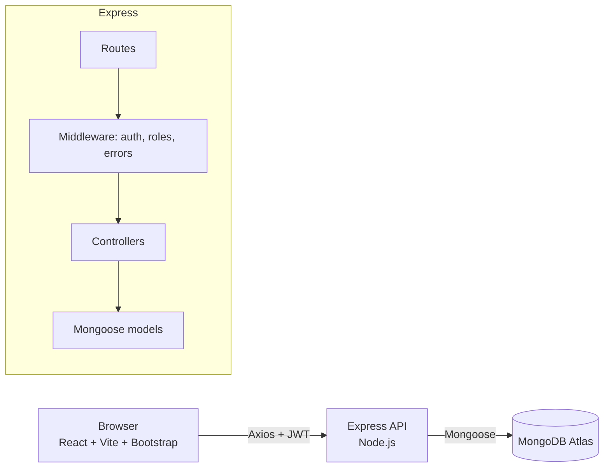

# BloodConnect – Project Guide (architecture, schema, viva)

## 1. Architecture

Request flow: React page → `services/api.js` (adds the JWT) → Express **route** → **middleware** (`protect` checks JWT, `authorize` checks role) → **controller** (business rules) → **model** (validation + MongoDB) → JSON response → React updates the screen and shows a toast.

## 2. Important files in plain language
| File | What it does |
|---|---|
| `backend/src/server.js` | Loads `.env`, connects to MongoDB, starts Express |
| `backend/src/app.js` | Sets up CORS, JSON parsing, all routes and the error handler |
| `backend/src/models/*.js` | Mongoose schemas = structure + validation of each collection |
| `backend/src/middleware/auth.js` | `protect` (must be logged in) and `authorize(role)` (right role) |
| `backend/src/controllers/requests.controller.js` | The heart of the app: create request, match donors, respond, status rules |
| `backend/src/utils/helpers.js` | Haversine distance, urgency sorting, small helpers |
| `frontend/src/context/AuthContext.jsx` | Keeps the logged-in user for the whole app |
| `frontend/src/components/ProtectedRoute.jsx` | Blocks pages for logged-out users / wrong roles |
| `frontend/src/pages/*` | One file per screen |

## 3. Database schemas
**User** – `name, email (unique), password (bcrypt hash, never returned), phone, role (donor|requester|hospital|admin), bloodGroup (required for donors), city, area, hospitalName, coordinates{lat,lng}, available, isActive, lastDonationDate, createdAt/updatedAt`.
Indexes: `{role, bloodGroup, city, available}` for donor search, `{role, createdAt}` for admin lists, unique `email`.

**BloodRequest** – `requester → User, patientName, bloodGroup, units(1-10), hospitalName, city, area, coordinates, contactNumber, requiredDate, urgency (normal|emergency|critical), notes, status (pending|accepted|completed|cancelled), matchedDonors[→User], responses[{donor→User, response, respondedAt}], acceptedDonor → User, acceptedAt, completedAt, firstResponseMinutes, createdAt/updatedAt`.
Indexes: status, bloodGroup+city, requester, matchedDonors, urgency.

**Notification** – `recipient → User, request → BloodRequest, type, message, read, createdAt`. Index: `{recipient, read, createdAt}`.

Relationships: one User (requester) has many BloodRequests; a BloodRequest references many donor Users (`matchedDonors`, `responses`) and one `acceptedDonor`; Users have many Notifications.

## 4. Key algorithms and rules
* **Haversine formula** (`utils/helpers.js`) – great-circle distance between two latitude/longitude points; donors are sorted nearest first when the requester shares a location.
* **Matching** (`utils/matching.js`) – active + available donors, same blood group, city match; used on request creation and on the donor search page.
* **Priority sorting** – critical → emergency → normal, newest first inside each group.
* **Duplicate-response prevention** – a donor must be in `matchedDonors`, may respond only once, and only while the request is `pending`.
* **Status transitions** – a lookup table in the controller; invalid moves return 400.
* **Privacy** – `serialize()` removes donor contact info from lists and reveals it to the requester only when the request is accepted/completed; the patient contact number is shown to a donor only after that donor accepted.
* **Response time** – `firstResponseMinutes = first response time − createdAt`; the admin dashboard averages it with a MongoDB `$avg` aggregation.

## 5. Security measures
bcrypt hashing · JWT auth · role-based access control · input validation (schema + controller) · `select:false` on password · central error handler · CORS allow-list · rate limiting on login/register · ownership checks on every update/delete · inactive accounts blocked at login and on every request · admin role cannot be self-registered · secrets only in environment variables.

## 6. Syllabus concepts implemented
HTML5 semantic layout, CSS3 (variables, flexbox, grid, media queries, animation), Bootstrap 5 grid/components, JavaScript ES6+ (modules, async/await, destructuring, spread), React (components, props, state, hooks `useState/useEffect/useContext`, context API, conditional rendering, lists/keys, controlled forms), React Router (nested routes, protected routes, params, query strings), Axios with interceptors, Node.js modules/ESM, Express (routing, middleware, error handling, REST), MongoDB (documents, indexes, aggregation, references/populate), Mongoose (schemas, validation, hooks, virtuals-free JSON transform), authentication & authorization (JWT, bcrypt, RBAC), environment configuration, Git/GitHub, cloud deployment (Atlas, Render, Vercel).

## 7. Likely viva questions
1. **Why MERN?** One language (JavaScript) end-to-end, JSON everywhere, large ecosystem.
2. **How does login work?** Server checks the bcrypt hash, signs a JWT; the browser stores it and Axios sends it in the `Authorization` header; `protect` verifies it on each call.
3. **Why hash passwords?** So that a database leak does not reveal real passwords; bcrypt is slow on purpose and salts each hash.
4. **JWT vs session?** JWT is stateless, so the API scales easily and works with separately hosted frontend/backend.
5. **How do you stop a donor accepting twice?** Check `responses` for the donor id before saving; return 409.
6. **How is privacy protected?** Contact fields are removed in `serialize()` and `findDonors()` until a donor accepts.
7. **What is Haversine?** Formula for distance between two points on a sphere using their latitude/longitude.
8. **Why indexes?** Faster searches on blood group, city and status; unique index on email prevents duplicates.
9. **Why no Socket.IO?** Reliability on free hosting; polling every 30 s gives a simple notification fallback. It could be added later.
10. **What are the limitations?** See README §13 (no compatibility matrix, no SMS/email, polling notifications).
11. **How would you scale it?** Pagination, geospatial `2dsphere` index and `$near` queries, Socket.IO/push notifications, caching, queue for notifications.
